## ユースケース図（手動作成）
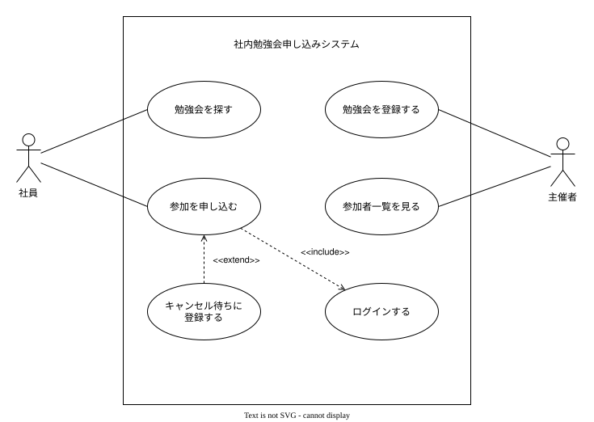

## アクティビティ図（参加を申し込む）
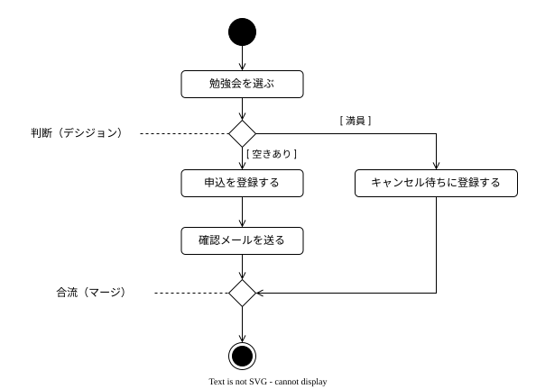

## ステートマシン図（申込の状態）
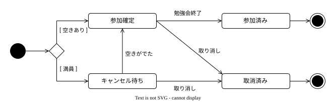

## クラス図
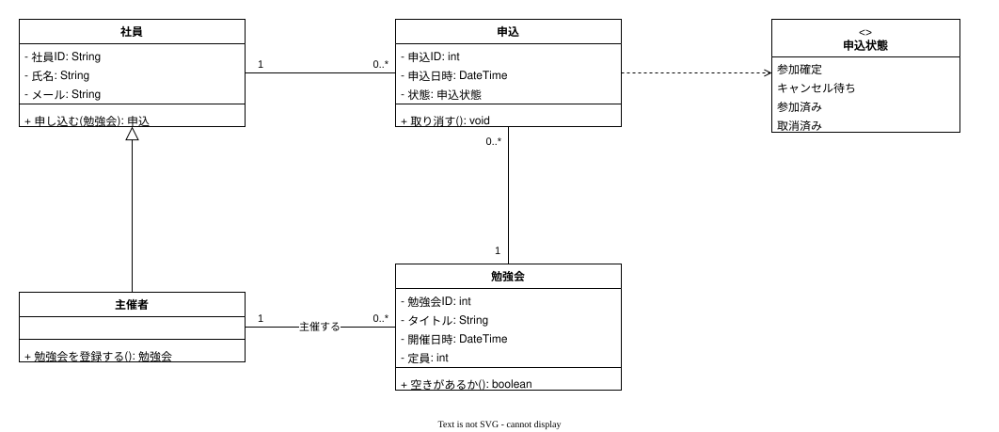

## シーケンス図
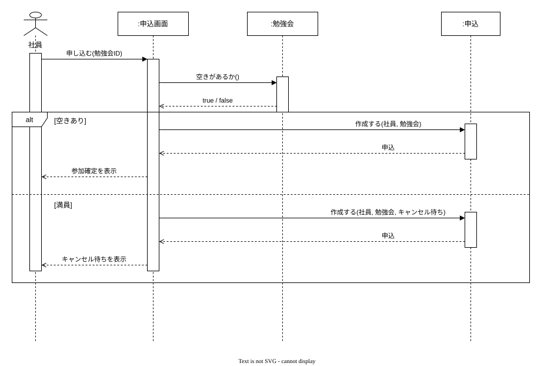

## ユースケース図（AI 作成）
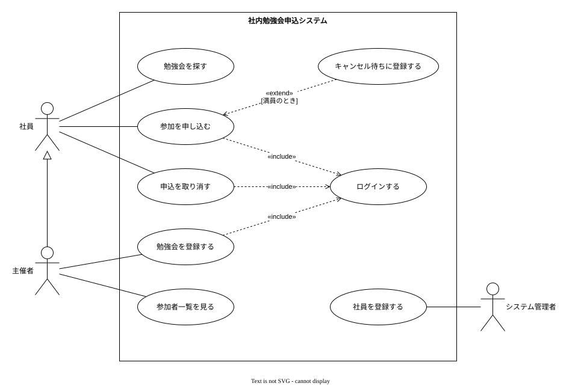

## アクティビティ図（勉強会を登録する）
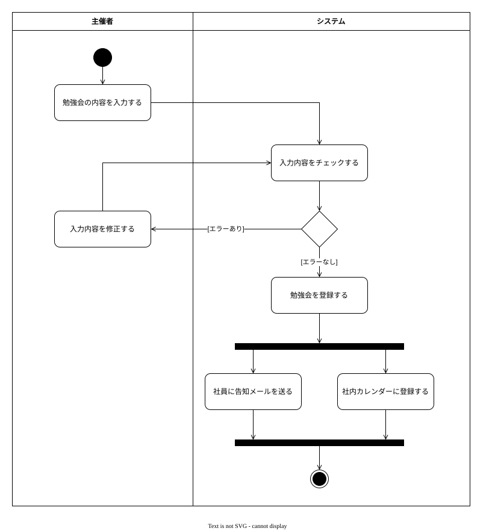

## ステートマシン図（申込の状態・AI 作成）
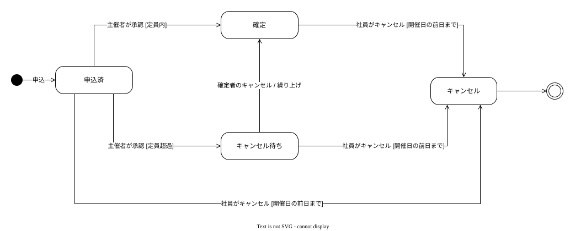

## シーケンス図（申込の取り消し）
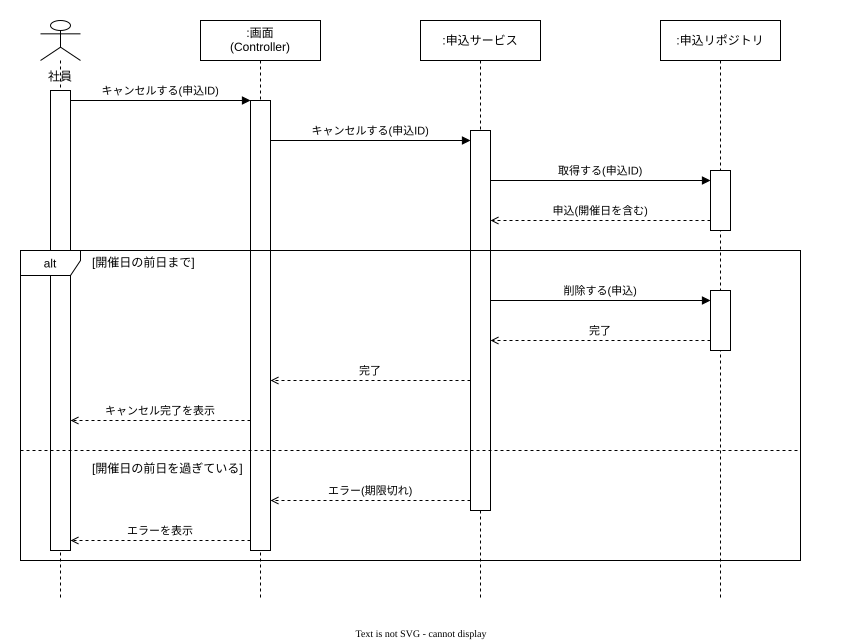

## ER図
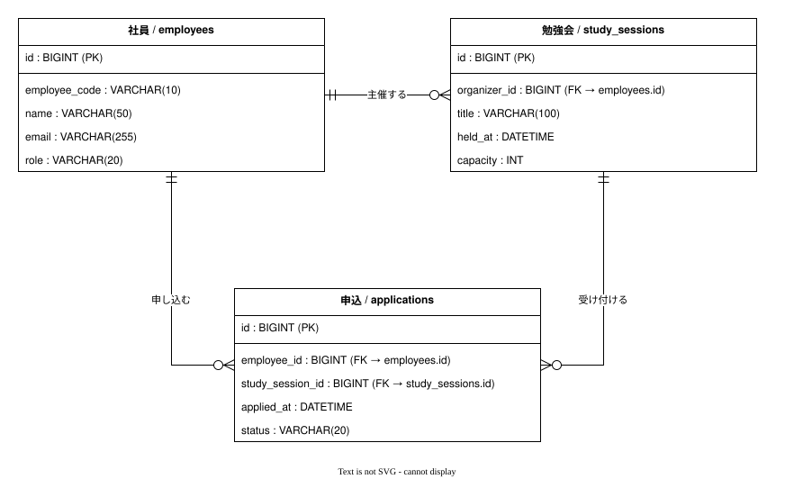

## 画面遷移図
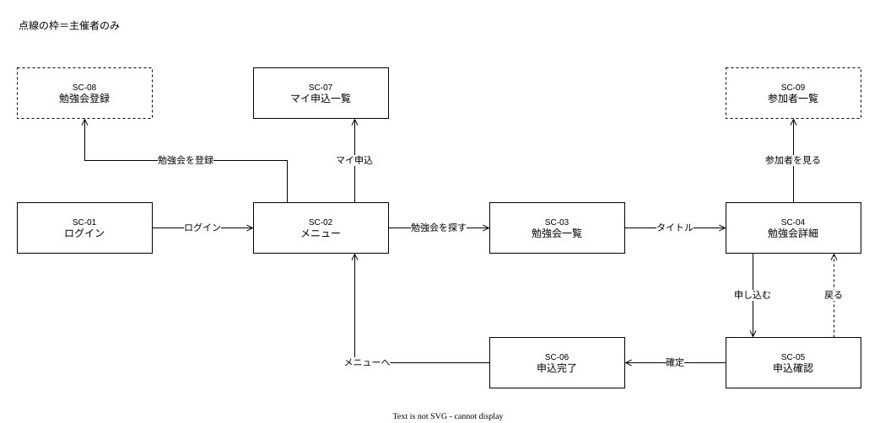

## ユースケース図（図書貸出・動作確認用）
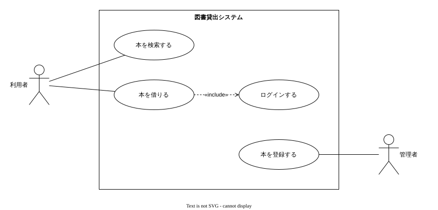

## シーケンス図（本を借りる）
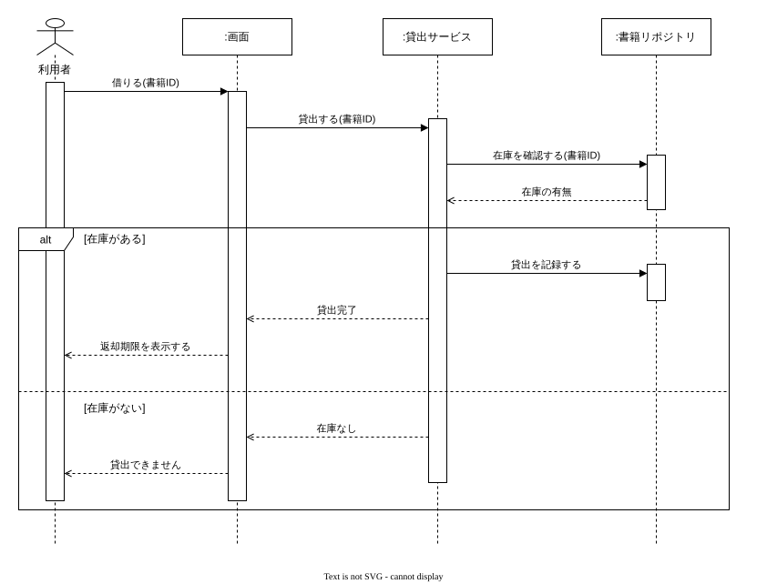
