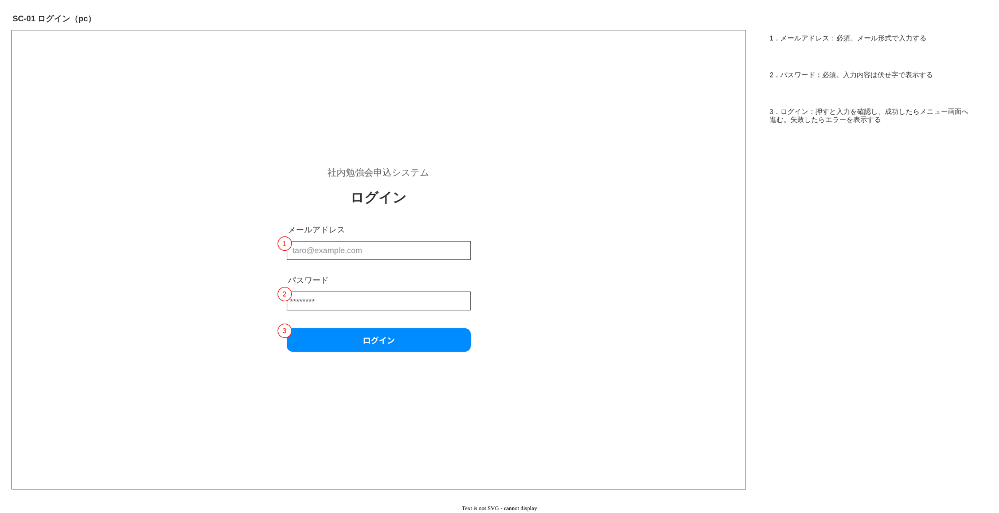
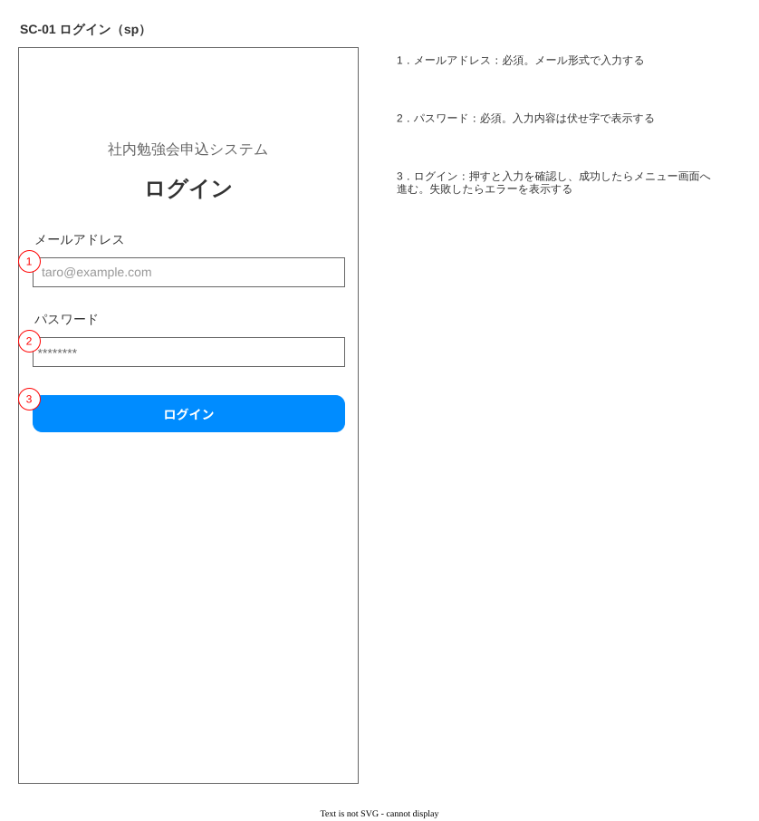
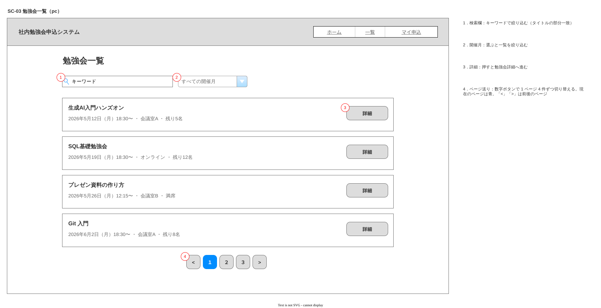
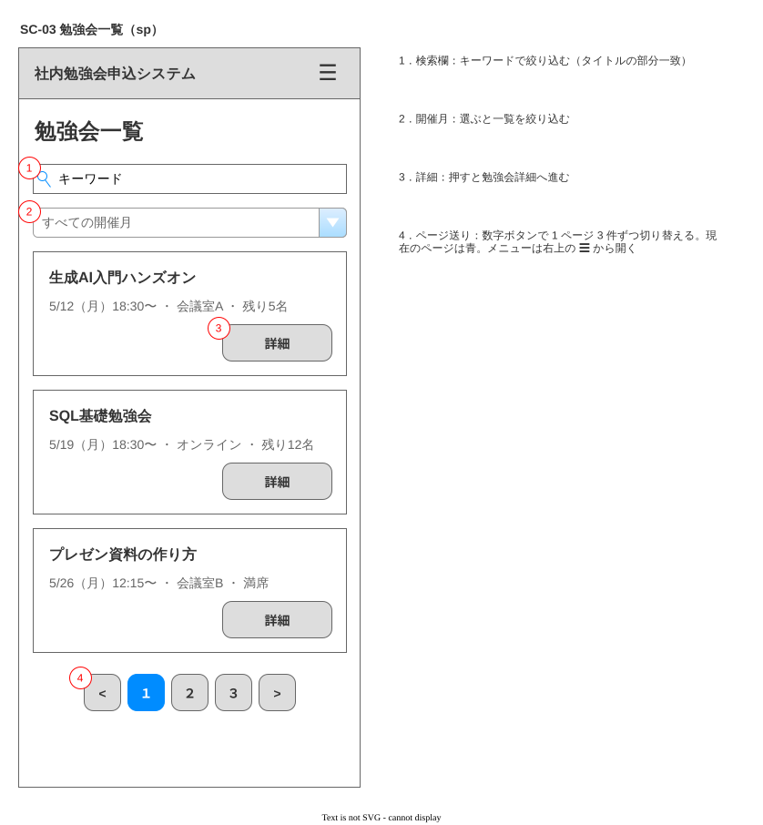
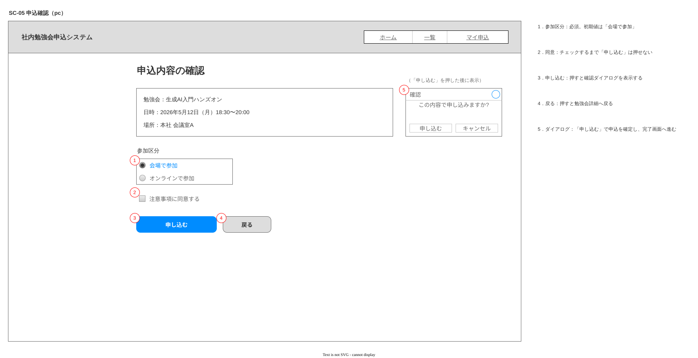
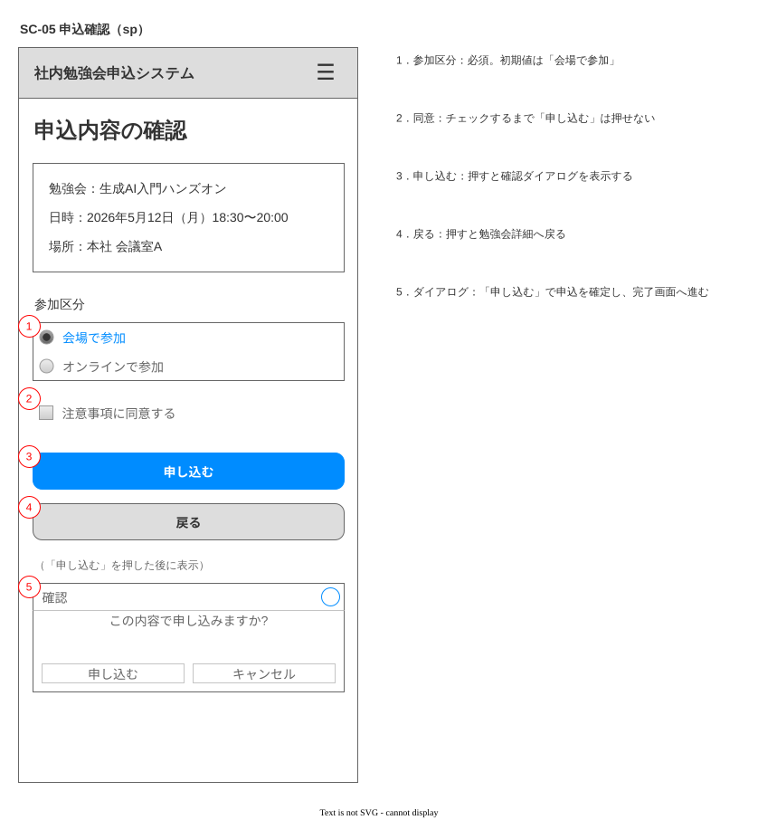
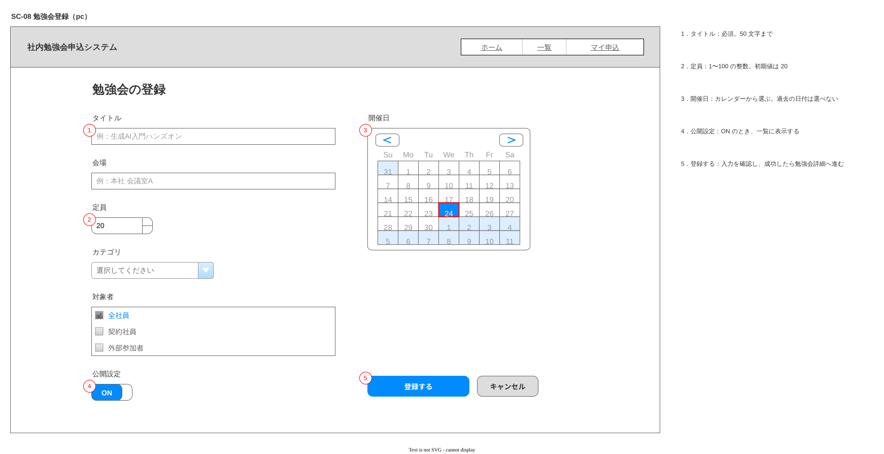
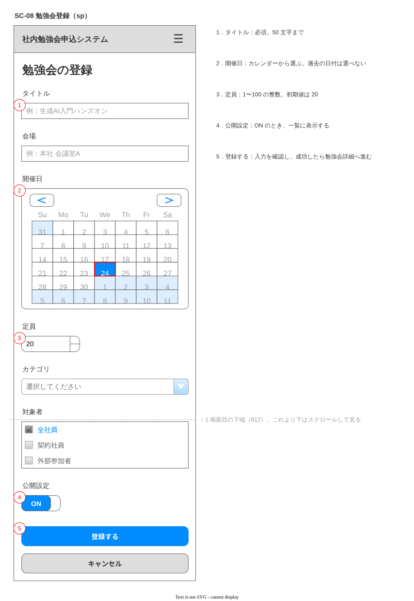
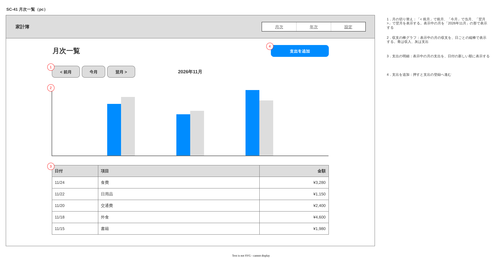
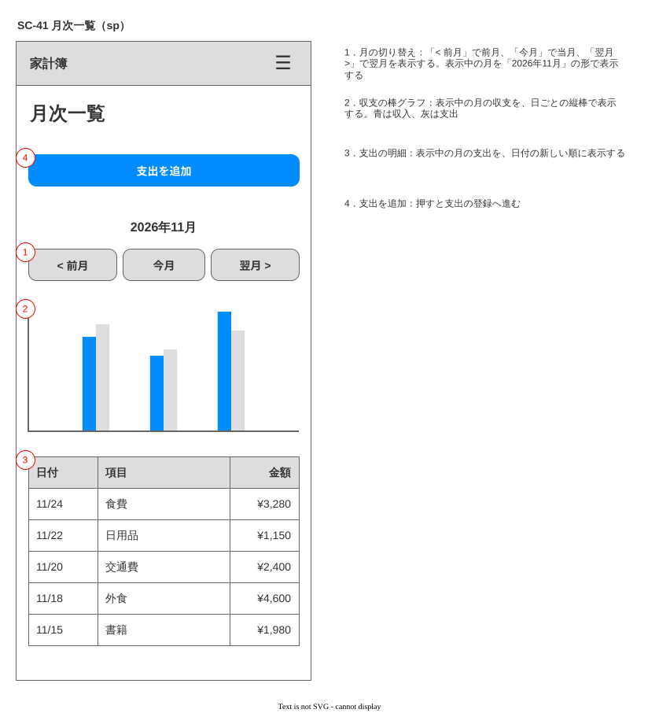

## SC-01 ログイン（pc）

## SC-01 ログイン（sp）

## SC-03 勉強会一覧（pc・ページ送りはボタン）

## SC-03 勉強会一覧（sp・ページ送りはボタン）

## SC-05 申込確認（pc）

## SC-05 申込確認（sp）

## SC-08 勉強会登録（pc）

## SC-08 勉強会登録（sp）

## SC-41 家計簿の月次一覧（pc）

## SC-41 家計簿の月次一覧（sp）

